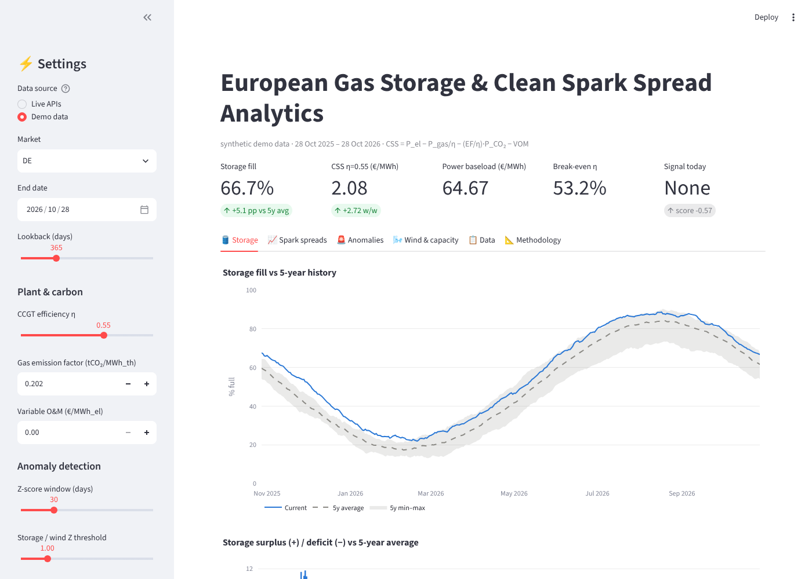
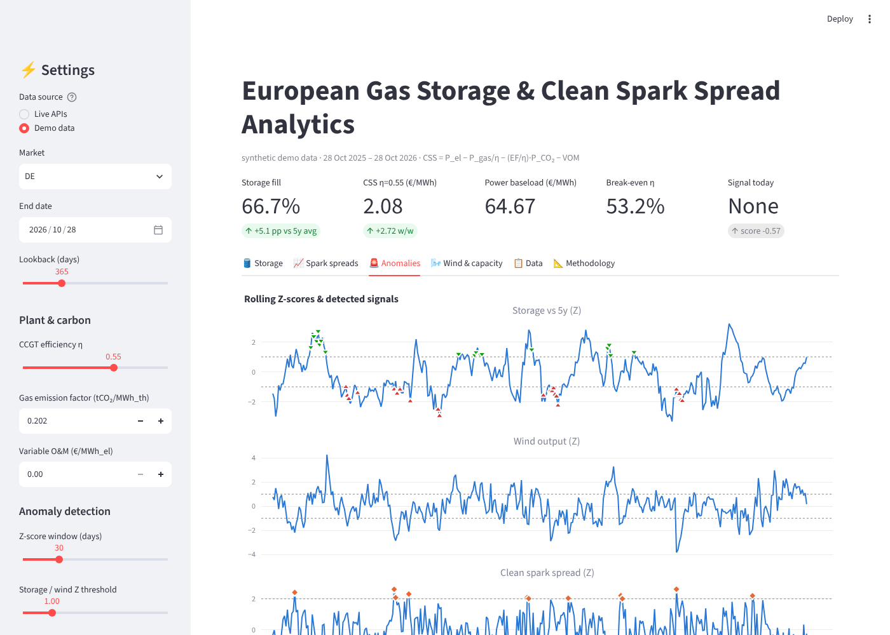

# European Gas Storage & Spark Spread Analytics Dashboard

An end-to-end Python pipeline and Streamlit dashboard that pulls **European gas storage** (GIE AGSI+)
and **power market data** (ENTSO-E Transparency Platform), computes **Clean Spark Spreads** across the
CCGT efficiency band, and flags anomalies with **rolling 30-day Z-scores**. For example, it flags days
when gas storage is unusually low and wind output is unusually low at the same time, which is a
bullish signal for power prices.



## Features

| Step | What it does | Code |
|---|---|---|
| 1. Data ingestion | AGSI+ daily storage (paginated JSON); ENTSO-E day-ahead prices (A44), wind onshore + offshore generation (A75), and installed capacity per production type (A68), parsed from IEC 62325 XML | `gasdash/agsi.py`, `gasdash/entsoe.py` |
| 2. Spread maths | Spark spread, Clean Spark Spread, carbon cost, break-even efficiency, and a CSS fan across η = 0.50–0.58 | `gasdash/spreads.py` |
| 3. Anomaly engine | 5-year same-calendar-day storage band, rolling Z-scores (trailing window that excludes the current day), and rule-based bullish/bearish/CSS-mispricing signals | `gasdash/analytics.py` |
| 4. Dashboard | Interactive Plotly charts in Streamlit: storage vs 5y average and min–max band, spread curves, cost stack, Z-score panels with signal markers, wind, capacity, CSV export | `app.py`, `gasdash/charts.py` |
| Automation | CLI pipeline, CI tests, and a daily scheduled GitHub Action that refreshes the data | `gasdash/pipeline.py`, `.github/workflows/` |

## Methodology

**Clean Spark Spread** for a gas plant with efficiency η:

```
CSS = P_power − P_gas / η − (EF_gas / η) · P_CO2 − VOM
```

* `EF_gas` = 0.202 tCO₂/MWh_th (IPCC default of 56.1 tCO₂/TJ)
* η is adjustable from 0.50 to 0.58. The dashboard draws the full band as a fan and the selected η as the main line.
* **Break-even efficiency** is `η* = (P_gas + EF·P_CO2) / (P_power − VOM)`. It is the least efficient plant that is still in the money.

**Storage vs 5-year history.** Each gas day is compared with the mean, min and max on the same calendar day
over the five previous complete years. 29 Feb shares the slot for 28 Feb.

**Rolling Z-score.** `Z_t = (x_t − mean(x_{t−30..t−1})) / std(x_{t−30..t−1})`

**Signals** (`k` = 1.0σ and `k₂` = 2.0σ by default; both can be changed in the sidebar):

| Signal | Rule |
|---|---|
| 🔺 Bullish power | Z(storage deficit vs 5y) < −k **and** Z(wind output) < −k |
| 🔻 Bearish power | both > +k |
| ◆ CSS rich / ◇ CSS cheap | \|Z(CSS)\| ≥ k₂, meaning the spread is far outside its recent range (a candidate mispricing) |



## Quick start

```bash
git clone https://github.com/GhaziGhani/-European-Gas-Storage-Spark-Spread-Analytics-Dashboard.git
```

```bash
cd -- -European-Gas-Storage-Spark-Spread-Analytics-Dashboard
```

```bash
pip install -r requirements.txt
```

```bash
streamlit run app.py
```

With no API keys set, the app opens in **Demo data** mode. Demo mode uses deterministic synthetic data
that has the same seasonal patterns, so you can explore every chart offline.

### Live data

1. Get a free **AGSI+ API key** at <https://agsi.gie.eu/account>.
2. Get an **ENTSO-E security token**: register at <https://transparency.entsoe.eu>, then e-mail
   `transparency@entsoe.eu` with the subject "Restful API access".
3. Provide the keys as environment variables (see `.env.example`) or in `.streamlit/secrets.toml`
   (see `.streamlit/secrets.toml.example`):

```bash
export GIE_API_KEY=...
```

```bash
export ENTSOE_API_KEY=...
```

4. **Gas and carbon prices.** There is no free official API for TTF or EUA settlement prices. Upload a CSV
   with the columns `date,gas_eur_mwh,co2_eur_t` in the sidebar (see `prices/prices.example.csv`), or use
   the flat-price inputs.

### Command-line pipeline

```bash
python -m gasdash.pipeline --country DE --days 365 --prices prices/prices.csv --out data/
```

```bash
python -m gasdash.pipeline --demo --out data/
```

This writes `data/analytics_<market>.csv` (all inputs, spreads, Z-scores and signals) and
`data/capacity_<market>.csv`.

Supported markets: DE (DE-LU), FR, NL, BE, AT, ES, IT (North), PL.

### Scheduled refresh

`.github/workflows/refresh-data.yml` runs the pipeline every day and uploads the CSVs as a workflow
artifact. To turn it on, add `GIE_API_KEY` and `ENTSOE_API_KEY` as repository secrets. To include CSS in
the scheduled run, commit a `prices/prices.csv`.

## Tests

```bash
pip install -r requirements-dev.txt
```

```bash
python -m pytest -q
```

The tests cover the spread formulas (hand-calculated values, the break-even identity, and monotonicity
in η), leap-year alignment of the 5-year band, Z-score maths, the signal rules, ENTSO-E XML parsing (A03
curve forward-fill, the no-data acknowledgement), AGSI pagination, and an end-to-end demo pipeline run
that also builds every chart.

## Project layout

```
app.py                 Streamlit dashboard
gasdash/
  agsi.py              GIE AGSI+ client
  entsoe.py            ENTSO-E client + XML parser
  prices.py            TTF / EUA price inputs
  spreads.py           spark / clean spark spread maths
  analytics.py         5y band, rolling Z-scores, signals
  pipeline.py          fetch → analyse orchestration + CLI
  charts.py            Plotly figures
  demo.py              synthetic data for offline use
tests/                 pytest suite
```

*The signals are screening tools for analysis. They are not trading advice.*
